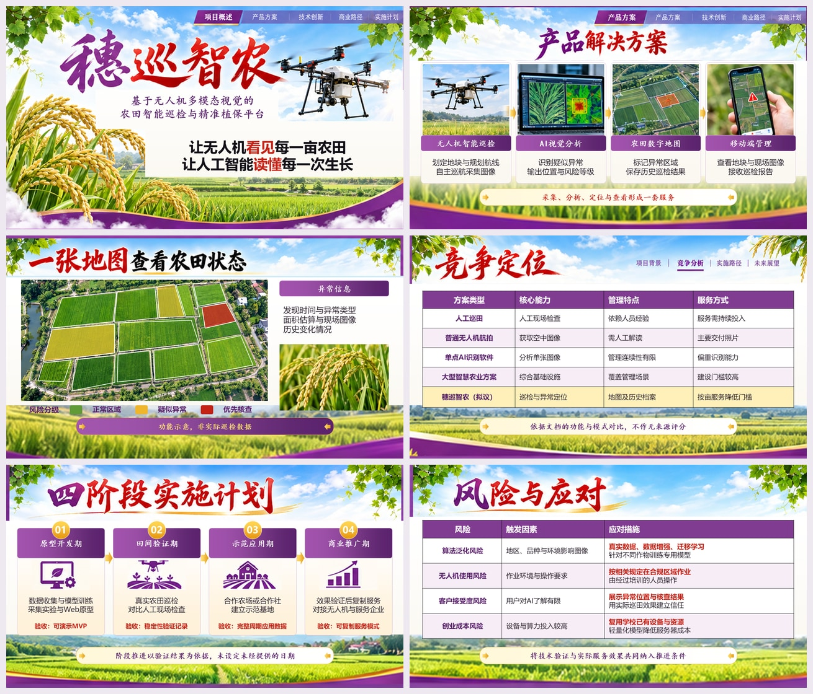
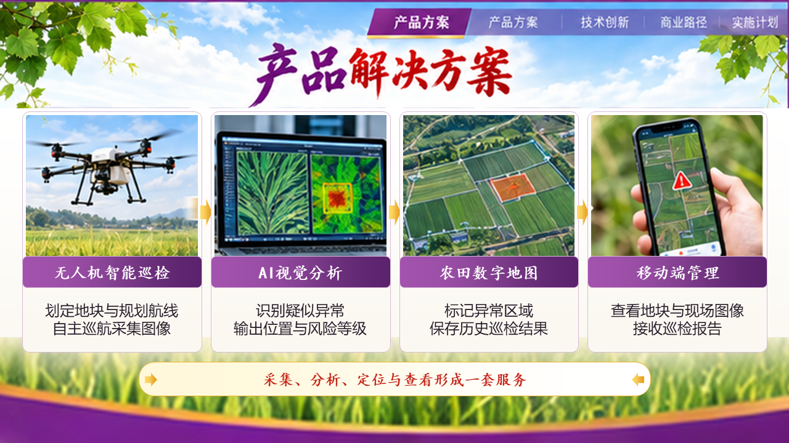
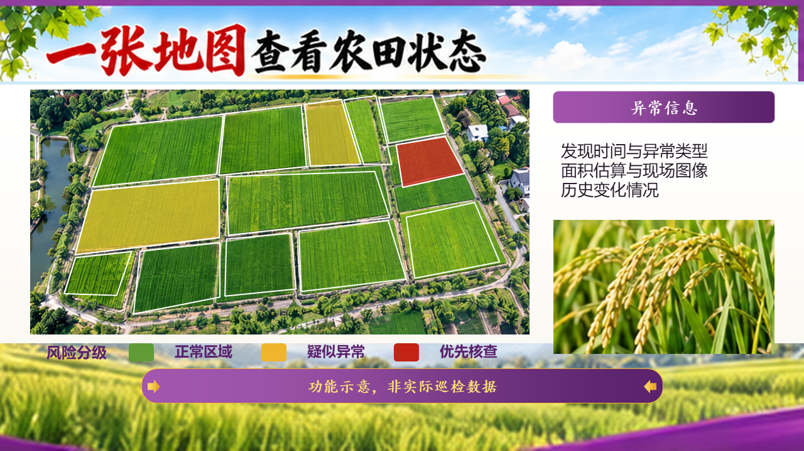
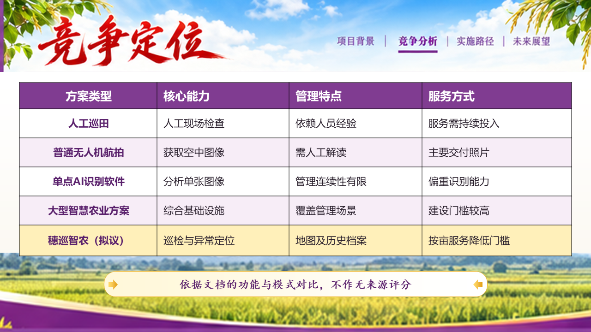
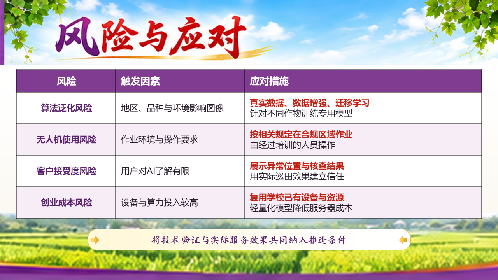

# PPT King

根据文档与参考图生成完整页面设计，再通过 API 从空白制作轻量可编辑 PPT。

适用于创业竞赛、项目汇报、学术答辩、参考风格重建，以及已有项目的局部续做。

## 示例效果

下面展示“穗巡智农”20页紫金风格示例中的6个页面。图片来自最终 PPTX 在 Microsoft PowerPoint 中的实际导出，展示的是交付文件的效果。



<details>
<summary>展开查看单页效果</summary>

### 封面


### 产品解决方案



### 农田状态地图



### 竞争定位



### 实施计划


### 风险与应对



</details>

示例按拟议方案与验证规划阶段呈现，场景为概念示意，并非真实田间试验成果。示例中的正文、两张表格、主要流程、编号、独立箭头及地图风险区域保留原生编辑能力；笔触标题、页眉装饰和复杂场景使用独立图片。封面和结束页的背景融合、部分纹理与原设计仍有差异。已通过 PowerPoint 的逐页渲染与副本编辑检查，WPS 未实测。

## 主要能力

- 依据文档组织准确文案，依据选定参考确定视觉风格。
- 先生成完整页面设计，再逐对象重建 PPTX。
- 默认轻量混合结构，兼顾主要内容可编辑与对象复杂度。
- 支持从空白重新生成，也支持新副本中的局部修复。
- 检查实际导出的页面、编辑能力、素材融合及性能。
- 附带4个风格条目与17个可复用组件，其中风格条目区分实际图片参考和文字方向预设。

## 安装

下载本仓库，把包含 `SKILL.md` 的整个文件夹命名为 `ppt-king`，放入个人 Codex 技能目录。

Windows 示例：

```text
C:\Users\你的用户名\.codex\skills\ppt-king\
```

macOS / Linux 示例：

```text
~/.codex/skills/ppt-king/
```

已有同名技能时，先保留旧版备份，再替换技能文件夹。保留 `assets`、`references`、`scripts` 和 `agents`，它们属于完整技能包。

## 使用

在支持技能的 Codex 会话中提供文档与参考图，并说明页数或汇报用途，例如：

```text
使用 $ppt-king 根据文档和参考图制作创业竞赛PPT。
从空白重新生成，正文、表格和关键流程可编辑。
```

也可以直接用自然语言：

```text
根据文档内容和参考图二，使用ppt-king重新生成PPT，不要在原有基础上修改。
查看PPT风格库。
查看组件 特征。
继续项目 <项目目录>，修复第7页地图及第18页表格。
```

默认流程为大纲确认、完整设计图、对象规划、API重建、检查修复与交付。已有且仍适用的确认可以复用。默认交付 PPTX，需要 PDF 或全部原生对象时在请求中明确说明。

## 运行能力

完整制作需要当前环境中的 ImageGen 图片工具与 presentations 技能支持。素材库脚本依赖 Python 标准库；三个可选的 PowerPoint 组件辅助脚本需要 Windows 桌面 PowerPoint。常规 API 生成不要求启动 PowerPoint。

## 文件结构

```text
ppt-king/
├── SKILL.md             技能入口
├── agents/              技能界面元数据
├── references/          流程、重建、编辑性及素材处理规则
├── scripts/             素材库与可选组件工具
├── assets/              风格参考和可复用组件
└── docs/images/         示例效果图
```

详细工作规则见 [SKILL.md](SKILL.md)。
